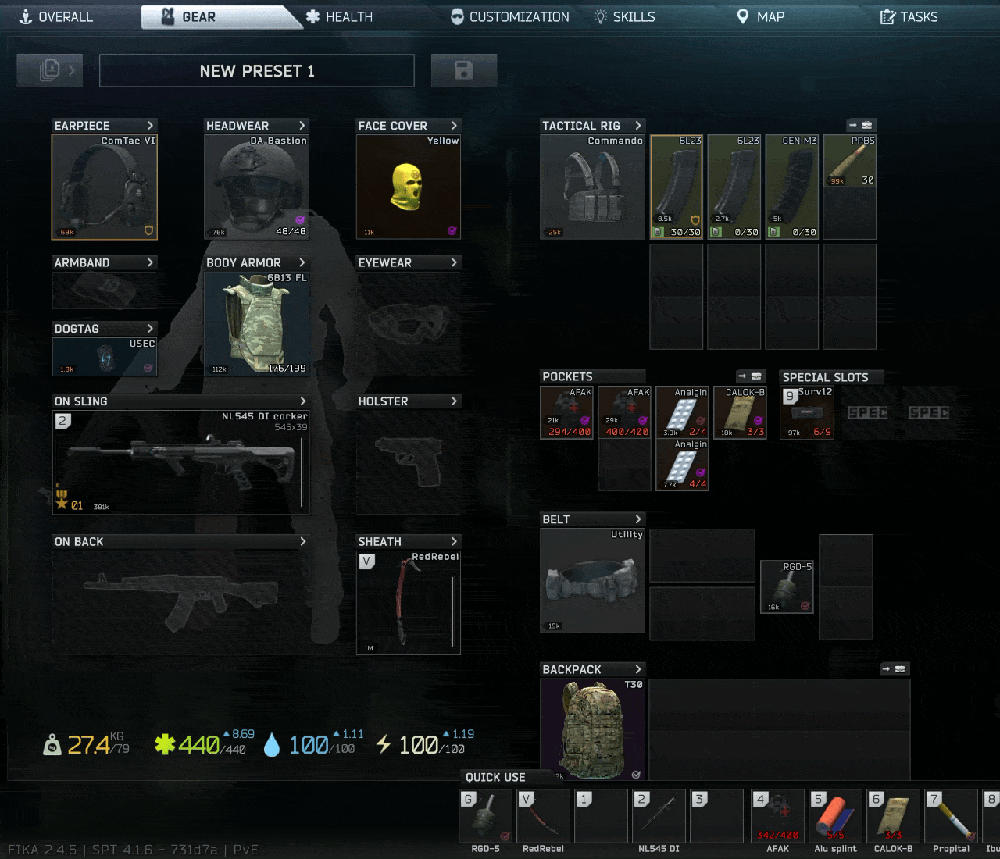
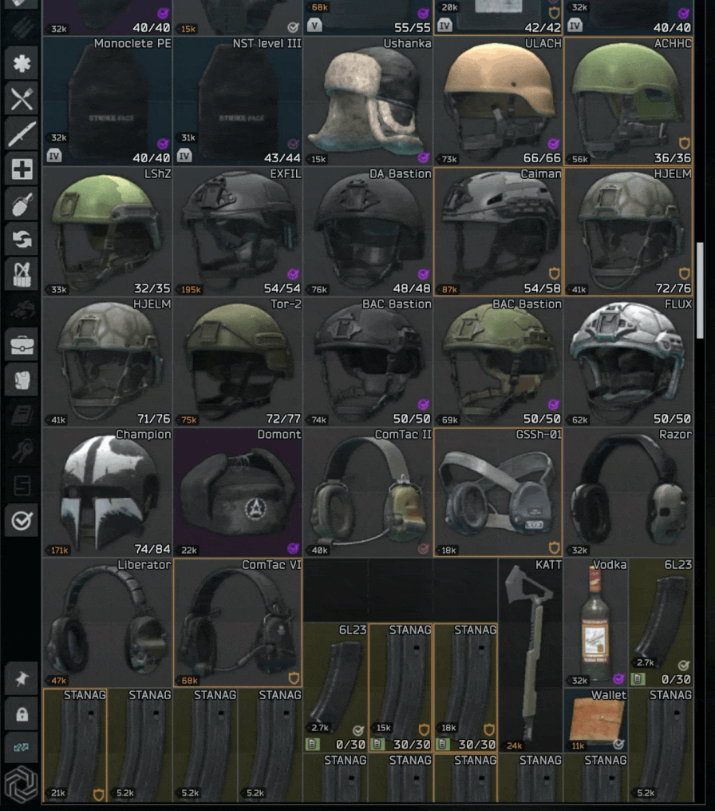

# Price Index

See what your loot is worth without leaving the game. Inspect an item and two rows are added under its stats:

- **Flea Market**: what it sells for on the flea
- **Best trader**: the trader who pays the most, and how much

Hover a row for the details. The same prices show under the item's name when you hover it, and every item in your stash and inventory gets a small price tag.

Prices count what's actually on the item: a gun's parts, armour plates, rounds in a magazine, and the condition of every part. What's packed inside a rig, bag or case isn't counted.

If you can't list an item on the flea yet (flea level, found in raid only, or Better Flea's bans and unlock levels), its flea price still shows, marked locked and orange on the tag, so you know only a trader will buy it for now.

## Made for Better Flea
Price Index is made to be used with [Better Flea](https://github.com/MrFums/BetterFlea), but works fine without it.

- **With Better Flea 2.3.0 or newer** on the server, the flea price is Better Flea's own price for that exact item, with its price multiplier, marked key multiplier and Wipe Cycle applied.
- **Without it**, or with an older Better Flea, the flea price is worked out from the base game's flea prices.

The flea row's tooltip says which one you're looking at.

## Install
SPT 4.1.x. Client only, nothing goes on the server. Extract the zip into your SPT folder. It puts the plugin in `BepInEx\plugins\PriceIndex`. Fika compatible, and not needed on a headless client.

To remove it, delete that folder.

## Settings
Press **F12** in game > Fums-PriceIndex.

- **Inspect window**: where the prices go in the inspect window, or off.
- **Hover tooltip**: prices under the item's name when you hover it.
- **Price on items**: a price tag on your items. Flea, best trader, or whichever pays the most (the default).
- **Price position on items**: bottom left, stepped up past the game's own icons, or halfway up the left edge.
- **Stacks**: price one item, the whole stack, or both.
- **Show in raid**, **Include Fence**, and how often flea prices are asked for again.

## Other mods
- **Choo² Trader Modding**: its price tags sit on the same items. Turn off its "Show price tags on items" and "Show flea price tags", or turn off Price Index's **Price on items**.
- **Show Me The Money**: both add prices to the hover tooltip, so you'll see two sets. Turn off its trader and flea prices, or Price Index's **Hover tooltip**. Its quicksell part works fine alongside.
- **Other mods that show prices on items or in tooltips** will do the same. Turn off the same feature in one of the 2 mods.

## Reporting issues
Please report issues in my Discord thread on the SPT server [here](https://discord.com/channels/875684761291599922/1562201063535415536), in this mods issue section, or on [GitHub issues](https://github.com/MrFums/PriceIndex/issues).

**Disclaimer:** Price Index was made with help from Claude, an AI model by Anthropic. Claude helped with the code, the code review, and the docs.
